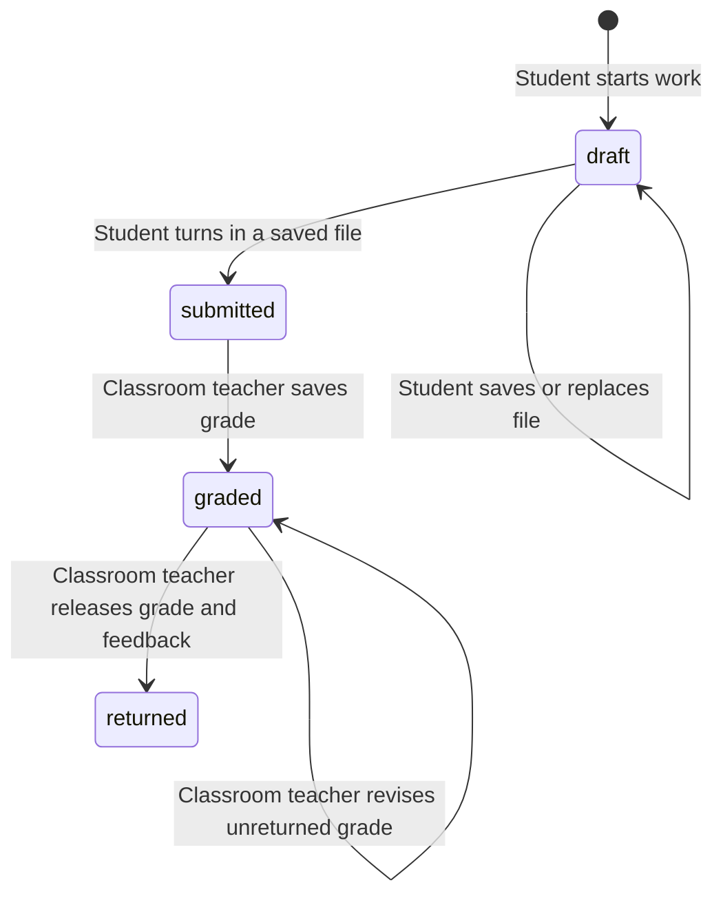

# Open-source comparison and assignment workflow

Reviewed on October 28, 2026. These are source-level comparisons, not claims that any reference project meets this application's security or concurrency requirements. No upstream implementation was copied, installed, or vendored. The new PHP and React code was written for the existing Laravel 11/Inertia monolith.

## References inspected

| Project and inspected revision | Observed approach | Decision for this LMS |
| --- | --- | --- |
| [Multicampus](https://github.com/monkmoshpit/multicampus/tree/560198e010eda3ab559e2c2a5fed99781edb89fa), revision `560198e` | Its README describes Laravel/Inertia/React and tenant-specific role portals. Its [GradeController](https://github.com/monkmoshpit/multicampus/blob/560198e010eda3ab559e2c2a5fed99781edb89fa/app/Http/Controllers/GradeController.php) scopes student grade reads and performs classroom/student grade upserts. | Keep role-specific Inertia views. Retain the existing classroom ownership boundary instead of adding tenancy. Keep grading attached to an individual assignment submission and use pagination. |
| [Laravel E-learning](https://github.com/mfarim/laravel-elearning/tree/2156785c1e472d8cc9bf6af65250ae5e951eb950), revision `2156785` | [Submission policies](https://github.com/mfarim/laravel-elearning/blob/2156785c1e472d8cc9bf6af65250ae5e951eb950/app/Policies/AssignmentSubmissionPolicy.php) distinguish viewing from grading. The [teacher component](https://github.com/mfarim/laravel-elearning/blob/2156785c1e472d8cc9bf6af65250ae5e951eb950/app/Livewire/Teacher/AssignmentSubmissions.php) scopes assignments to the teacher and bounds scores by assignment maximum. The [student component](https://github.com/mfarim/laravel-elearning/blob/2156785c1e472d8cc9bf6af65250ae5e951eb950/app/Livewire/Student/Assignments.php) stores a public file and upserts a submitted record. | Adopt explicit authorization and assignment-specific grade limits. Implement the interface with React. Keep files private, separate saving a draft from turning it in, and recheck state under a row lock. |
| [Canvas LMS](https://github.com/instructure/canvas-lms/tree/1c9f0bb8013ed69c4f2efe11fd483025469b7e6c), revision `1c9f0bb` | Its [submission model](https://github.com/instructure/canvas-lms/blob/1c9f0bb8013ed69c4f2efe11fd483025469b7e6c/app/models/submission.rb) explicitly tracks submitted/graded workflow states, submission timestamps, late status, and whether grades match attempts. | Use explicit transitions and actual turn-in timestamps. Preserve the requested four-state model without adding attempt/version history or porting Canvas's extensive model behavior. |

The two Laravel READMEs describe MIT licensing; GitHub's API did not identify a license for either during this review, so this review does not treat those claims as a verified reuse license. Canvas's API identifies AGPL-3.0. This implementation borrows general workflow ideas only and contains no copied upstream source.

## Implemented behavior

Teachers can create classrooms from My classrooms and post assignments from their classroom stream. Assignment ownership comes from the authenticated teacher and route-bound classroom; request fields cannot override it. Due dates entered in the browser's local time are sent as ISO timestamps and normalized to UTC.

Students open an assignment and explicitly start a draft. Merely viewing an assignment does not write to the database. Repeated draft creation uses the existing unique assignment/student key and never resets submitted, graded, or returned work. The student saves a private file before turning it in. Late work is accepted and marked using the due date and actual `submitted_at` timestamp.

The allowed mutations are:



Returned work remains locked, matching the original requirement. Grades and feedback remain hidden from students until returned. Teachers cannot download students' drafts. Students can download only their own files while enrolled; an owning teacher can download turned-in work. File downloads reauthorize every request and use attachment responses with private caching and `nosniff`, never public storage URLs.

## Concurrency decisions

- Draft creation uses a unique assignment/student key and an idempotent insert rather than a check-then-create sequence.
- File writes and turn-in lock the same submission row and reauthorize against the current database state. A stale draft object cannot overwrite turned-in work. Turn-in also verifies that the saved object still exists.
- Grading locks the assignment first and the submission second, then updates both the grade and `class_average` in the same transaction. Different graders for one assignment serialize through the same parent row. Other assignments have independent locks.
- The average includes both graded and returned submissions. Revising a grade recalculates it rather than incrementally adding a second contribution. Zero is a valid grade. Grade limits are rechecked against the locked assignment's maximum.
- Returning a grade locks the submission. It retains the same grade and therefore does not change the average. A returned row cannot be graded through a stale form.
- Grade activity does not broadcast into the classroom stream. Assignment posting still uses the existing after-commit private invalidation event. Learners refresh the assignment to retrieve returned results.
- Submission review uses cursor pagination of 20 turned-in rows and eager loads student names. It never fetches a full classroom roster or private drafts.

Future user/assignment deletion or reassignment flows must maintain the cached average and honor these lock conventions. No such mutation endpoints are introduced here. File retention cleanup and scalable private storage remain deployment work described in the foundation guide.

## Implementation map

| Responsibility | Files |
| --- | --- |
| Tracking | `database/migrations/2026_10_28_000001_track_submission_workflow.php` adds submitted/returned timestamps, feedback, and grader FK |
| Authorization | `AssignmentPolicy`, extended `ClassroomPolicy` and `SubmissionPolicy` |
| Domain actions | `CreateAssignment`, `StartSubmission`, `TurnInSubmission`, `GradeSubmission`, `ReturnSubmissionGrade` |
| Request validation | `StoreClassroomRequest`, `StoreAssignmentRequest`, `GradeSubmissionRequest` |
| HTTP | `ClassroomController`, `AssignmentController`, `SubmissionWorkflowController`, private download in `SubmissionFileController` |
| UI | `Assignment/Show.tsx`, `student-work.tsx`, `submission-review.tsx`, classroom and assignment creation forms |
| Regression tests | `tests/Feature/AssignmentWorkflowTest.php` |
| Browser verification | `tests/Browser/assignment-workflow.spec.ts`, `playwright.config.ts` |

## Verification

Verified locally: **39 PHP tests passed (221 assertions), 2 Chromium browser tests passed, TypeScript/Vite build passed, Pint passed, and Git whitespace checks passed**. The additive workflow migration was applied to the existing local application database. Desktop and mobile screenshots were reviewed from the browser-test artifacts.

`php artisan test` covers the foundation and full HTTP workflow, including forged ownership, outsider access, idempotent drafts, file requirements, download permissions, draft privacy, grade privacy, grade bounds, stale updates, late work, pagination, and aggregate recalculation. SQLite verifies functional behavior, not PostgreSQL row-lock contention or PostgreSQL-only constraints.

`npm.cmd run build` checks TypeScript and builds production assets. `npm.cmd run test:e2e` runs Chromium against a separate Laravel server on port 8010 and an isolated SQLite database in `storage/framework/testing/browser-workflow.sqlite`. Its setup resets only that test database, seeds test-only credentials, and leaves the application's database and demo accounts alone. The browser test creates a classroom, joins it, posts an assignment, uploads and turns in work, saves a hidden grade, releases it, and downloads the original file. It also checks the student classroom list at a mobile width.

On a fresh checkout, install browser binaries before the first browser run:

```powershell
npx.cmd playwright install chromium --no-shell
npm.cmd run build
npm.cmd run test:e2e
```

Test uploads use `storage/framework/testing/browser-files`. The application uses its existing private file root unless `PRIVATE_FILES_ROOT` is explicitly configured. Test credentials and encryption keys are fixed test-only values applied exclusively to the isolated server; they are not application credentials.

Before a production concurrency claim, run this workflow on PostgreSQL with separate simultaneous connections and perform load tests. The current Laravel 11 support/security limitation remains documented in [the foundation guide](foundation.md).
